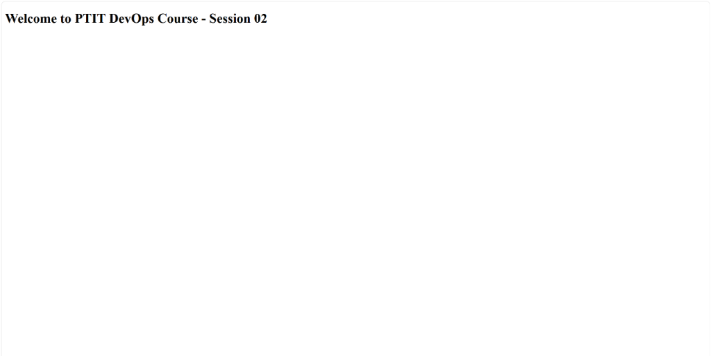

# Bài 3: Cài đặt Nginx và cấu hình Website tĩnh cơ bản (Basic Nginx Web Server)

## 📁 Cấu trúc thư mục nộp bài
```text
homework/session_02/ex3/
├── index.html        # Trang HTML tĩnh với dòng chữ theo yêu cầu
├── ptit-web.conf     # File cấu hình Nginx Server Block
├── setup.sh          # Script hỗ trợ cài đặt tự động trên máy chủ Ubuntu
└── README.md         # Hướng dẫn chi tiết
```

---

## 🛠️ Hướng dẫn cài đặt và cấu hình trên Ubuntu Server

### Bước 1: Cài đặt Nginx
```bash
sudo apt update
sudo apt install -y nginx
```

### Bước 2: Tạo thư mục chứa mã nguồn tĩnh
```bash
sudo mkdir -p /var/www/ptit-web/html
sudo chown -R $USER:$USER /var/www/ptit-web/html
sudo chmod -R 755 /var/www/ptit-web
```

### Bước 3: Tạo trang web tĩnh (`index.html`)
Tạo file `/var/www/ptit-web/html/index.html` chứa nội dung hiển thị:
```html
Welcome to PTIT DevOps Course - Session 02
```

### Bước 4: Tạo cấu hình Server Block (`ptit-web.conf`)
Tạo tệp cấu hình tại `/etc/nginx/sites-available/ptit-web.conf`:
```nginx
server {
    listen 80;
    listen [::]:80;

    server_name _;

    root /var/www/ptit-web/html;
    index index.html index.htm;

    location / {
        try_files $uri $uri/ =404;
    }
}
```

### Bước 5: Kích hoạt Server Block và xóa trang mặc định
```bash
# Tạo symlink kích hoạt ptit-web.conf (dùng -sf để đè nếu có symlink cũ hỏng)
sudo ln -sf /etc/nginx/sites-available/ptit-web.conf /etc/nginx/sites-enabled/

# Xóa file mặc định default
sudo rm -f /etc/nginx/sites-enabled/default
```

### Bước 6: Kiểm tra và Khởi động lại Nginx
```bash
# Kiểm tra cú pháp cấu hình
sudo nginx -t

# Nạp lại cấu hình dịch vụ Nginx
sudo systemctl reload nginx
```

---

## 🔍 Kiểm tra kết quả
1. Mở trình duyệt web trên máy cá nhân.
2. Truy cập địa chỉ: `http://<IP_ADDRESS_DROPLET>`
3. Trình duyệt hiển thị dòng chữ: **"Welcome to PTIT DevOps Course - Session 02"**.



